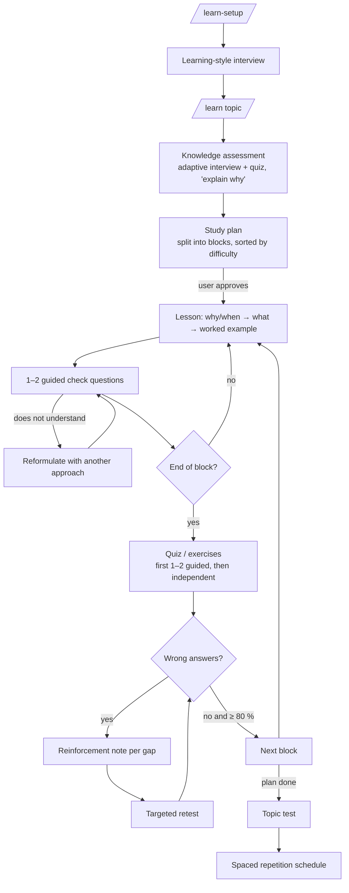

# Learning Curve — design

A pi package that turns pi into a structured STEM tutor. It writes every explanation,
quiz, test and exercise into the user's note-taking app (Obsidian by default), adapts
explanations to what the user knows **and** to how the user understands, verifies math
with tools, and keeps knowledge alive with spaced repetition.

## 1. Goals

| # | Goal |
|---|---|
| G1 | Use pi itself as the learning platform. |
| G2 | STEM first (math, physics), LaTeX everywhere. |
| G3 | Explanations adapted to the learner's **knowledge** (assessment interview/quiz) and **learning style** (style interview + continuous observation). |
| G4 | Intuition first (why / when, real cases), then formal (what). Reasoning over memory. |
| G5 | Study plan sorted by difficulty before teaching; big topics split into blocks. |
| G6 | Quizzes/exercises after lessons or blocks; every wrong answer is a gap → reinforcement note → targeted retest. Pass = ≥ 80 % **and** no open gaps. |
| G7 | Everything saved in the note app with a fixed structure (subject → topic → lessons / quizzes / tests / exercises). |
| G8 | Math checked by tools (SymPy), visuals with Manim / plots / Obsidian plugins. |
| G9 | Spaced repetition. |
| G10 | Distributable as a pi package. |

## 2. Activation model

The package is installed once (`pi install git:…` or local path). It is **dormant** in
normal coding sessions and becomes a tutor only inside a *learning workspace*:

- A learning workspace is a directory containing `.learning-curve/config.json`
  (normally the Obsidian vault root, or any parent pi is started from).
- In a workspace the extension:
  - replaces pi's coding-assistant preamble with the tutor persona;
  - activates the learning tools (inactive elsewhere);
  - contributes the learning skills and prompt templates (not advertised elsewhere) and
    advertises only the learning skills to the tutor;
  - shows a status line (active topic, lesson, due reviews, open gaps).
- Outside a workspace only `/learn-setup` is meaningful; other commands explain how to
  create or open a workspace.

## 3. Workspace layout (vault)

```
<Vault>/
├── .learning-curve/              machine data (hidden from Obsidian)
│   ├── config.json               app, languages, thresholds, capabilities
│   ├── state.json                curriculum, attempts, gaps, review schedule
│   ├── app-profile.md            what the tutor learned about the note app
│   ├── venv/                     Python (uv) with sympy, numpy, matplotlib, manim
│   └── scenes/                   Manim sources
├── 00 Learner/
│   ├── Profile.md                knowledge map (generated from state + notes)
│   ├── Learning Style.md         how the user understands (interview + observations)
│   ├── Dashboard.md              progress + due reviews (Dataview)
│   └── preamble.sty              shared LaTeX macros (Extended MathJax)
└── <Subject>/
    ├── <Subject>.md              subject index (folder note)
    └── NN - <Topic>/
        ├── NN - <Topic>.md       topic index (folder note)
        ├── Study Plan.md
        ├── Flashcards.md         flashcards of the topic (if enabled)
        ├── Lessons/
        │   └── 01 - <Lesson>/
        │       ├── 01 - <Lesson>.md
        │       ├── Reinforcement - <concept>.md
        │       └── media/        Manim videos, plots
        ├── Quizzes/              short checks after a lesson
        ├── Tests/                block / topic tests
        └── Exercises/            practice sets with hidden solutions
```

Every note has YAML frontmatter (`type`, `subject`, `topic`, `lesson`, `difficulty`,
`status`, `created`, `updated`, `tags`) so Dataview dashboards work.

## 3b. Subjects and shared topics

- A **subject** is a course: goal, broad assessment, ordered **syllabus** of topics
  (dependency first, then difficulty), optional **final exam**.
- A topic has exactly **one home subject** (the folder holding its notes). Other subjects
  list it in their syllabus as a **link**; `topic.subjects` records every subject using it
  and notes carry `subjects: [...]` plus one `subject/…` tag per subject.
- Creating a topic whose name exists in another subject is rejected by the tool: the
  tutor must link it (`home`) or create a **bridge topic** with a distinct name that
  builds on it (different angle, 1–3 lessons).
- A linked topic that is done counts as done in every subject that uses it.
- A subject is done when every syllabus topic is done and (if enabled) the final exam is
  passed with no open gaps in the subject; exam gaps land on the question's topic and
  the retest that closes the last one completes the exam.
- Removing a topic from a syllabus deletes untouched stubs and unlinks shared topics;
  progress is never lost.

## 4. Learning flow



Principles enforced by the persona and skills:

1. **Assessment first** — never teach a topic without knowing the user's level.
2. **Why/When → What, per concept** — the lesson opens with motivation and a real case;
   each concept is built intuitively and closed by its formal, official statement (in an
   `[!info]` box), then a worked example and a reasoning question. Lesson notes are
   organised by concept in numbered sections (`1.`, `1.1`) grouped by kind of content.
3. **Concise, one logical thread** — each step follows from the previous one; no
   unexplained jumps; short paragraphs.
4. **Justify** — quizzes ask for the reasoning, not only the result.
5. **Verify** — every computed result, derivation step or numeric answer is checked with
   `math_check` before it is written or graded.
6. **Gaps are data** — a wrong answer is recorded as a misconception even if the quiz is
   passed; it is cleared only by a correct retest.
7. **Reformulate on request** — when the user says they do not understand a note, the
   tutor rewrites that section **in place** using a different approach (chosen from the
   learning style profile), bumps the note's `revision` property, and records which
   approach worked in the style profile.
8. **Learn the learner** — style observations (analogies, visuals, proofs, examples
   first, …) are recorded continuously and shape the next explanations.

## 5. Components

### 5.1 Extension (TypeScript, `extensions/`)

| Module | Responsibility |
|---|---|
| `index.ts` | Entry: workspace detection, tool activation, persona injection (`before_agent_start`), skills/prompts discovery, status line. |
| `runtime.ts` | Active workspace, serialized state mutations (file mutation queue), vault path guard. |
| `setup.ts` | `/learn-setup` wizard. |
| `commands.ts` | `input` router (`/learn` → `/skill:learn-topic` …) and `/progress`. |
| `ui/checklist.ts` | Multi-select checklist (TUI; confirm fallback in RPC). |
| `lib/workspace.ts` | Config/state load & save, marked-section updates. |
| `lib/paths.ts` | Canonical vault paths, safe names. |
| `lib/curriculum.ts` | Topic plans, lesson status, block checkpoints (pure). |
| `lib/scoring.ts` | Quiz scoring, gaps, knowledge map, review scheduling (pure). |
| `lib/srs.ts` | SM-2 scheduler (pure). |
| `lib/persona.ts` | Tutor preamble + dynamic `<learning_context>` section. |
| `lib/notes.ts` / `lib/render.ts` | Templates, scaffolding, generated sections (Dashboard, knowledge map, lesson tables). |
| `lib/plugins.ts` / `lib/obsidian.ts` | Plugin catalog, installer (GitHub releases → `.obsidian/plugins`), plugin settings seeding. |
| `lib/python.ts` / `lib/exec.ts` | uv venv, package install, LaTeX/MiKTeX detection and install, process runner with env. |
| `tools/*.ts` | LLM tools (below). |

### 5.2 Tools (active only in a workspace)

| Tool | Purpose |
|---|---|
| `learning_state` | Overview; subject overview; find existing topics across subjects; subject assessment and syllabus (with links to other subjects); topic assessment and plan; lesson status; active subject/topic/lesson; canonical note paths and template values. |
| `quiz_ask` | Interactive TUI question: multiple choice, numeric, short, open/proof. Optional progressive hints (guided mode) and "explain why" follow-up. Returns the user's answer(s). |
| `quiz_record` | Record a graded attempt (per question: concept, correct, reasoning quality, error, topic for exams). Computes score, pass/fail, opens/closes gaps, schedules reviews, completes subject final exams. |
| `learner_profile` | Read/update knowledge levels per concept and style observations. |
| `review_queue` | List due review items; record review outcome (updates schedule). |
| `math_check` | Run a SymPy/NumPy script in the workspace venv and return its output (timeout, truncated). |
| `code_run` | Run code in the learner's language (20 built-in runners + custom commands), stdin/args, compile errors apart; `check` reports installed toolchains and how to install missing ones. |
| `note_check` | Obsidian formatting check of a note, folder or the whole vault (also runs automatically on every write/edit of a note via `tool_result`). |
| `source_lookup` | Fact checking: learner's sources (vault `Sources/`, PDFs via pypdf, page citations), NIST CODATA, NIST DLMF, OEIS, Encyclopedia of Mathematics, Wikipedia, nLab, arXiv, Crossref, any URL. Relevant excerpts with LaTeX kept, citations, cache. |
| `manim_render` | Render a Manim scene into the lesson `media/` folder and return the embed link. |
| `plot_render` | Render a matplotlib figure to PNG in `media/`. |

### 5.2b Terminal math

pi's Markdown renderer already draws `$…$`/`$$…$$` as Unicode (`renderLatex` in pi-tui).
`math-display.ts` registers a display-only Markdown transformer that expands the vault
`preamble.sty` macros (parsed from `\newcommand`/`\DeclareMathOperator`, cached by mtime)
when the expanded formula is renderable, and renders math in quiz dialogs
(`renderMathText`). Session content and model context are never modified.

### 5.3 Commands

Learning commands are not extension commands: an `input` handler rewrites `/learn x` into
`/skill:learn-topic Topic: x` before skill expansion, so the skill is injected exactly like
a typed skill command (robust in TUI, RPC and print mode). Prompt templates with the same
names (contributed only in a workspace) provide autocomplete and descriptions. Outside a
workspace the router answers with a hint to run `/learn-setup`.

| Command | Action |
|---|---|
| `/learn-setup` | Create or reconfigure a workspace (wizard). |
| `/check-notes [path]` | Run the note checker; optionally ask the tutor to fix the errors. |
| `/learn-plugins` | Manage Obsidian plugins: recommended list, community catalog search, update, disable, remove; syncs `config.plugins`. |
| `/new-subject <name>` | Start a subject: interview, broad assessment, syllabus (skill `subject-plan`). |
| `/learn [topic]` | Start or resume a topic, or the active subject's next topic. |
| `/exam [subject]` | Final exam of a subject. |
| `/lesson [next\|n]` | Continue with the next (or given) lesson. |
| `/quiz [lesson\|block\|topic]` | Quiz on current lesson/block, or topic test. |
| `/exercises [n]` | Generate an exercise set. |
| `/reformulate [note or concept]` | Rewrite an explanation another way. |
| `/review` | Run due spaced-repetition reviews. |
| `/progress` | Show progress and open gaps; refresh Dashboard. |
| `/style` | (Re)run or refine the learning-style interview. |
| `/grade <note>` | Grade answers the user wrote directly in a quiz/exercise note. |

### 5.4 Skills (contributed only in a workspace)

`memory-aids`, `fact-checking`, `subject-plan`, `learn-topic` (orchestrator), `learning-style-interview`, `knowledge-assessment`, `study-plan`, `lesson-writing`,
`quiz-and-exercises`, `reinforcement`, `reformulation`, `spaced-review`,
`math-verification`, `visuals` (Manim, plots, TikZ, Desmos), `notes-obsidian`,
`notes-adapter` (learn and use another note app).

### 5.5 Note templates

Lesson, study plan, quiz, test, exercise set, reinforcement, topic index,
subject index, profile, learning style, dashboard.

## 5b. Two hosts: pi and Claude Code

```
extensions/lib/*        core: state, notes, lint, kinds, runners, sources, srs, setup, status (no pi imports)
extensions/lib/schema.ts   typed JSON Schema builder (no dependencies) — pi and MCP accept plain JSON Schema
extensions/lib/tool.ts     ToolDef { name, parameters, execute(params, env) }, UiPort for dialogs
extensions/tools/*      every tool defined once (platform-neutral)
extensions/pi-tools.ts  pi adapter: registerTool + pi-only renderers; UiPort = pi dialogs
extensions/index.ts…    pi-only: persona injection, commands, wizards, math display, status
claude/mcp-server.ts    Claude Code adapter: MCP stdio server (no dependencies); UiPort = elicitation forms
claude/hooks.ts         SessionStart (housekeeping + persona/context), PostToolUse (note check)
claude/platform.ts      what differs in Claude Code (tool names, quiz forms, chat math per client)
claude/run.mjs          launcher: checks Node ≥ 22.18 (type stripping), runs the .ts entry points
.claude-plugin/, .mcp.json, hooks/hooks.json, commands/   Claude Code plugin packaging
```

The vault and `.learning-curve/` are the same for both hosts. Claude Code client detection uses
`CLAUDE_CODE_ENTRYPOINT` (`cli`, `claude-vscode`, `claude-desktop`): the VS Code extension renders
`$…$` and `$$…$$` with KaTeX, the desktop app only `$$…$$`, the terminal nothing (Unicode in chat).
Quiz forms (MCP elicitation) show only the first lines of their message: the tutor writes the
questions in chat first, and LaTeX in forms is converted to plain text (`lib/texplain.ts`).

## 6. Setup wizard (`/learn-setup`)

1. Note app — **Obsidian (recommended)**, Logseq, Zettlr, Joplin, plain Markdown folder,
   other (the tutor learns it: docs research and/or user interview → `app-profile.md`).
2. Vault / notes folder path (default: current directory).
3. Notes language (conversation follows the user's language).
4. Obsidian plugins — curated list with recommended ones preselected; installed by
   downloading their GitHub releases into `.obsidian/plugins/` and enabling them
   (Obsidian must be restarted and Restricted mode turned off).
5. Python tools — create `.learning-curve/venv` with uv (Python 3.12) and install
   `sympy numpy matplotlib manim`; detect LaTeX (needed by Manim `MathTex`) and offer
   MiKTeX via winget.
6. Learner notes, LaTeX preamble, plugin settings (Homepage → Dashboard, Extended
   MathJax preamble), app profile stub for non-Obsidian apps.
7. Reload; `/style` is prefilled to start the learning-style interview.

### Recommended Obsidian plugins (by downloads, Nov 2026)

| Plugin | Why | Default |
|---|---|---|
| Latex Suite | Fast LaTeX typing (snippets, auto-fractions) | ✔ |
| Extended MathJax | Shared preamble/macros, extra MathJax packages | ✔ |
| TikZJax | TikZ diagrams (geometry, circuits, commutative diagrams) | ✔ |
| Desmos | Interactive function graphs | ✔ |
| Dataview | Progress dashboards from frontmatter | ✔ |
| Spaced Repetition | In-app flashcards/note review | ✔ |
| Folder notes | Subject/topic index notes on folders | ✔ |
| Excalidraw | Hand-drawn diagrams | ✔ |
| Omnisearch | Full-text search | ✔ |
| Homepage | Open the Dashboard on start | ✔ |
| Advanced Tables | Table editing | ✔ |
| Charts | Data charts | ○ |
| Media Extended | Better video playback (Manim) | ○ |
| Templater | Templates for manual notes | ○ |
| Execute Code | Run Python blocks in notes | ○ |
| Git | Vault versioning/backup | ○ |
| Style Settings, Iconize | Appearance | ○ |

Built in, no plugin needed: MathJax (`$…$`, `$$…$$`), callouts, Mermaid, video embeds.

## 7. Data model (`state.json`)

```jsonc
{
  "version": 1,
  "active": { "subject": "Mathematics", "topic": "Linear Algebra", "lesson": 3 },
  "topics": {
    "Mathematics/Linear Algebra": {
      "status": "in-progress",
      "assessment": { "level": "beginner", "date": "…", "notes": "…" },
      "blocks": [{ "name": "Vectors", "lessons": [1, 2, 3] }],
      "lessons": [{ "n": 1, "title": "…", "difficulty": 1, "status": "done", "concepts": ["…"] }]
    }
  },
  "attempts": [{ "id": "…", "kind": "quiz", "scope": "…", "score": 0.85, "passed": false,
                 "questions": [{ "concept": "…", "correct": false, "error": "…" }] }],
  "gaps": [{ "concept": "…", "topic": "…", "opened": "…", "status": "open", "reinforcement": "path" }],
  "reviews": [{ "id": "…", "concept": "…", "note": "path", "due": "…", "interval": 3, "ease": 2.5, "reps": 2 }],
  "style": { "observations": [{ "date": "…", "signal": "…", "evidence": "…" }] }
}
```

## 8. Testing

- Unit tests (`node --test`, Node ≥ 22.6 strips TypeScript types): SM-2 scheduling,
  scoring and gaps, curriculum, paths, marked sections, wikilinks in tables, input
  routing, checklist component.
- Integration (manual, recorded in the 0.1.0 work): `pi -p` in a sample vault for
  activation scoping, tools (`math_check`, `plot_render`, `manim_render`, bookkeeping),
  `/learn` and `/lesson` flows; `/learn-setup` driven over RPC mode.
